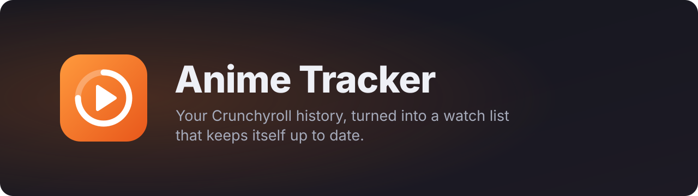
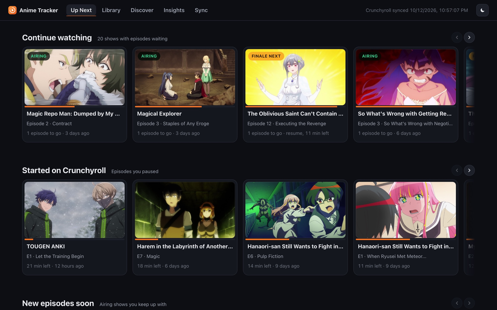
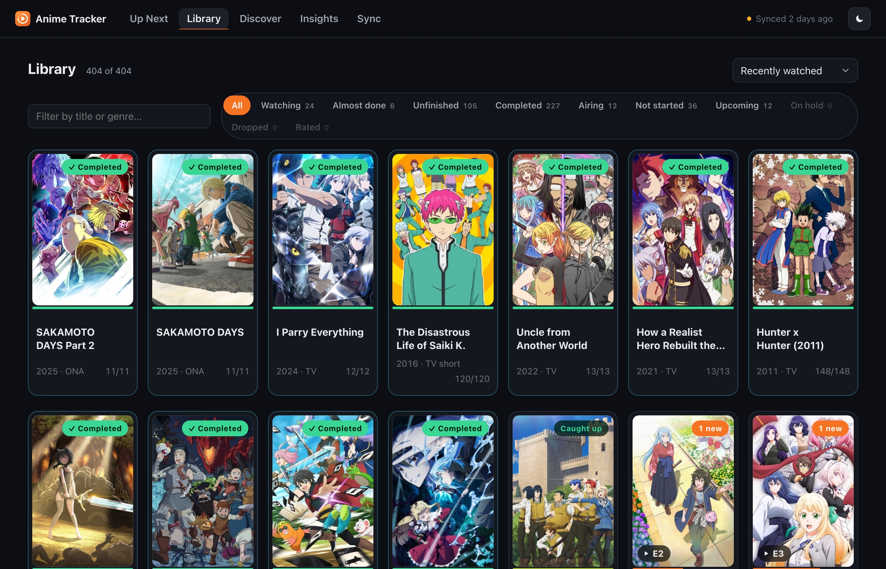
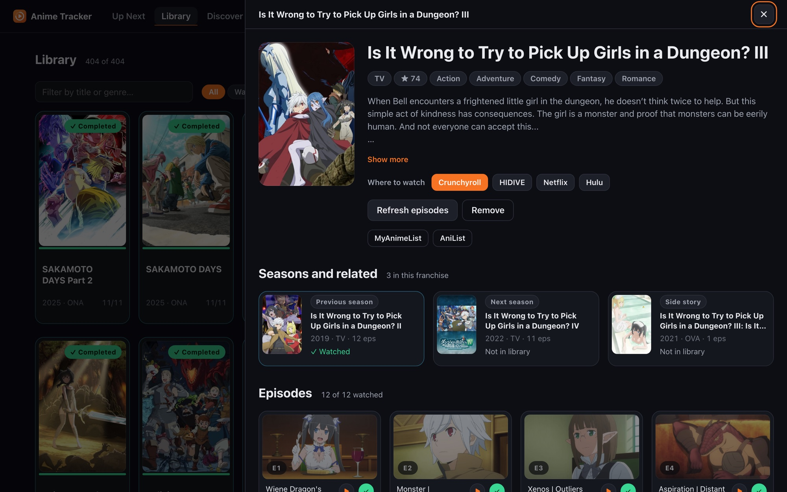
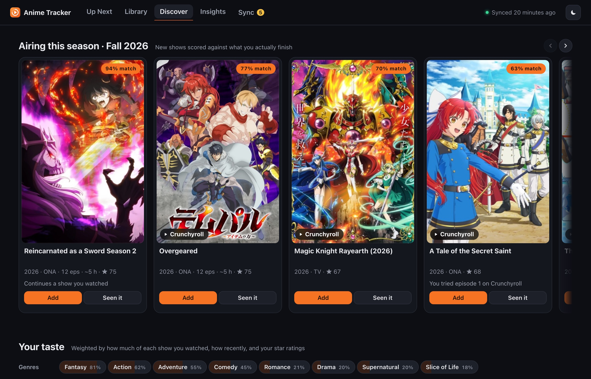
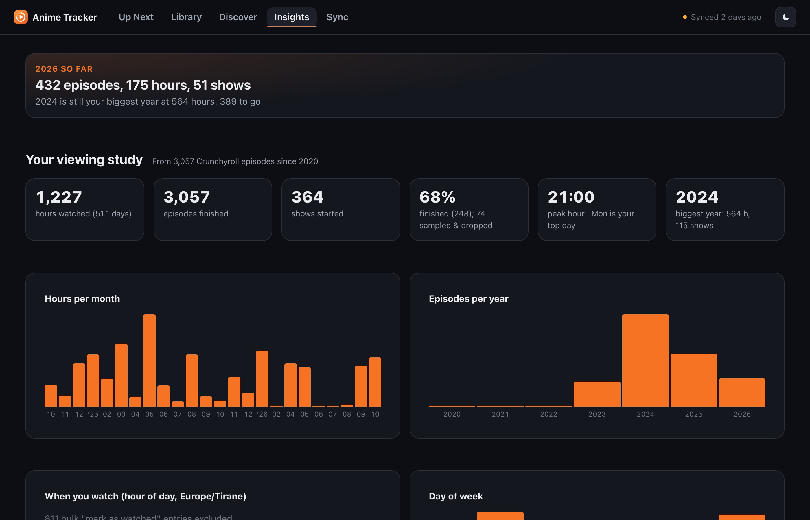
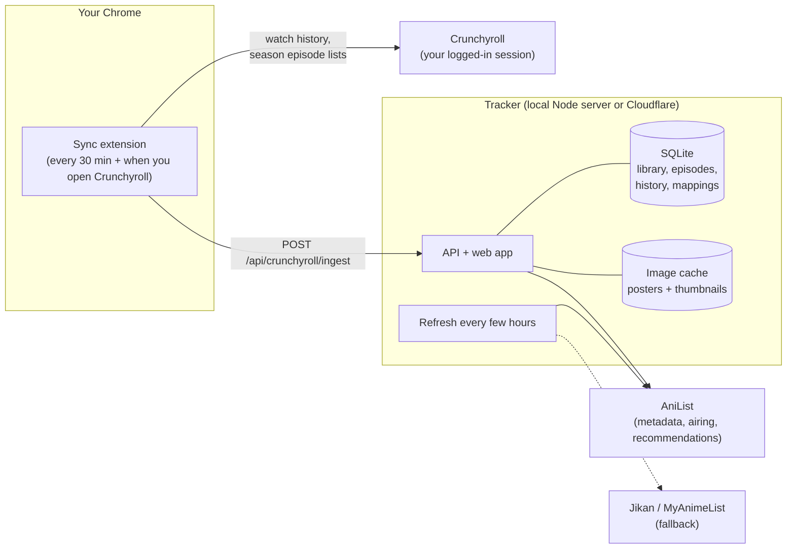
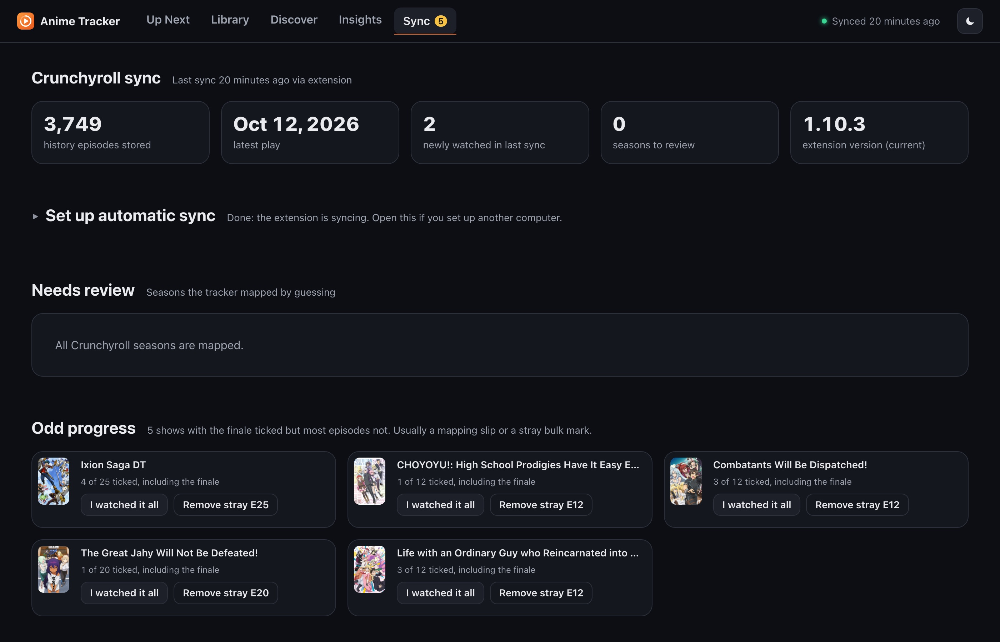

<p align="center">
  
</p>

<p align="center">
  <a href="LICENSE"></a>
  
  
  
</p>

Crunchyroll's history page is a long list of episodes in the order you played them. It can't tell you which show you dropped two episodes before the end, that the sequel to something you finished last year is out, or that you've already seen half of a "new" recommendation on Netflix.

Anime Tracker reads that history and works those things out. It maps every Crunchyroll episode to a MyAnimeList entry, fills in the rest from AniList, and keeps it all current through a small Chrome extension. You get one page that answers "what do I watch tonight?", a library with real progress, recommendations based on what you actually finished, and some numbers about your habits.

It's built around a real account: 3,884 Crunchyroll history entries going back to 2016, about 400 shows and 5,600 episodes. It runs on your own machine, or on Cloudflare Workers behind a passphrase.

<p align="center">
  
</p>

## What it does

**Up Next.** A line says what arrived since your last visit ("Since Saturday: new episodes of Magic Repo Man and Magical Explorer"). One pick for tonight at the top: a paused episode first, then a show with an episode out since your last visit, then whatever you were most recently into, with a Surprise me button when you can't decide. Below it, "Finish what you started" collects the shows you left one or two episodes before the end, then Continue watching: every show with episodes waiting, newest episodes first, each with a Play button that opens that exact episode on Crunchyroll (or the show's page, or Netflix or HIDIVE when that's where it streams) and how long the rest takes. Time chips (30 min, 1 h, 2 h) narrow the row to what fits your evening. A check on each card marks an episode watched; Shift-click marks everything that's aired. Further down: shows you just finished, with stars so a rating is one tap away; this week's airing schedule by day; the airing shows you're caught up on; Coming soon, the announced next seasons of shows you finished with their premiere months; new seasons you can start today, with one-tap Add; and the shows you stopped partway, with Hold and Drop. Each Continue card has a ⋯ menu with Hold, Drop and Details, and the secondary sections can be hidden (remembered per browser). Every one-click action has Undo, including removing a show (its rating and list state come back too) and bulk ticks like Mark all watched. The page paints from its last state instantly and refreshes behind that.

**Library.** Everything you've watched or added, with a badge for where you are: completed, almost done, unfinished, caught up on an airing show (with when the next episode lands), watching, not started, upcoming, on hold, dropped. Every filter shows its count and, for in-progress views, how long finishing everything would take. Group seasons shows one card per series instead of one per season. Select lets you pick any number of shows and put them on hold, drop them or make them active again in one go (one Undo puts each back the way it was). "Fewest episodes left" sorts the shows you're two episodes from finishing to the front, and the Unfinished view splits into 1–2 left and Barely started, with Hold and Drop on each card plus one button to shelve everything untouched for a year. Upcoming cards show the start date. Progress forgives gaps in old history: a show counts as finished when its finale and at least three quarters of its episodes are watched. In-progress cards carry Play and tick buttons like Up Next.

**Show details.** Play next at the top, then synopsis, genres, score, runtime (or time left), your star rating, hold and drop, every episode with its still and a Play button (watched ones fold away behind a count, so a 148-episode show opens on what's next; for an airing show, the next episode shows when it airs and the rest wait in one line), the rest of the franchise with your progress on each and one-tap Add, and "More like this": what AniList users who liked the show recommend. When a season is finished the panel offers the next one, following AniList's sequel links through OVAs to the real next TV season. "Where to watch" lists the official services AniList knows about, plus a direct Crunchyroll series link found through your history, AniList, or Crunchyroll's own search.

**Discover.** At the top, this season's airing anime scored against what you actually finish (continuations of your shows first). Below that, Recommendations for shows you haven't watched, built from AniList's community recommendations of the shows you engaged with most. A show you finished counts for more than one you sampled for two episodes, recent watching counts for more than something from 2019, and your star ratings scale it further: five stars counts double, one or two stars count against. Filters for length, "on Crunchyroll" and release year; a Crunchyroll link on the poster when it's there; Hide with Undo. Sequels of things you've seen are left out on purpose. The list is precomputed in the background, so the page opens instantly.

**Insights.** This year so far against your biggest year, this week against last week, your watch streak, hours watched, completion rate, when you watch (by hour and weekday, in your timezone), your biggest binge days, top shows, what you finish by genre, and the genres and themes you keep coming back to. Crunchyroll's bulk "mark as watched" button stamps hundreds of episodes within seconds of each other; those are counted in the totals but kept out of the habit charts, and an episode watched in several dubs counts once. Your years is a year in review for every year you've watched: hours, episodes, shows, the busiest month and your five most-watched shows. At the bottom, Recently watched is your history by day, one row per episode, and both it and the Library export to CSV for spreadsheets.

<table>
  <tr>
    <td></td>
    <td></td>
  </tr>
  <tr>
    <td></td>
    <td></td>
  </tr>
</table>

**Search and keyboard.** Search ignores punctuation and knows the nicknames AniList lists, so "jjk", "re zero" and "returners magic" all find their shows, in the Library filter and in ⌘K / Ctrl+K, which opens any show by name (or searches AniList) and also runs commands like sync, calendar, import, review or theme; `/` jumps to search, 1–5 switch tabs, `?` lists them all.

**Airing calendar.** The Sync page has a private calendar link to subscribe to in Google Calendar, Apple Calendar or Outlook: each airing show's next episode at its real time plus the following weeks, refreshed every few hours (shows on hold or dropped are left out). The link is a long random secret you can replace at any time; it reveals titles and air times, nothing else.

**Sync page.** Import a public AniList list by username, or a MyAnimeList list export (episodes watched, scores as stars, on hold and dropped; nothing already watched is ever un-watched). Seasons the tracker matched by guessing (fix one by searching for the right show), shows with odd progress (a finale ticked with most episodes not, usually a stray bulk mark; fix it, or Leave as is if you really skipped ahead), Crunchyroll seasons you sampled but never tracked, backups, and the extension's version.

**On your phone.** The site installs to the home screen (Add to Home Screen on iOS, Install on Android) and opens offline with whatever it showed last time. Syncing stays on the computer; the phone is for checking what's next and ticking things off. Long-press the icon (Android, desktop) for shortcuts: Play tonight's pick goes straight to that episode on Crunchyroll; the others open Up Next, unfinished shows or Discover.

**Notifications.** Sync → Notifications turns on web push for the device you're holding (on iPhone, from the home-screen app). The background refresh then sends one when a show you're watching has a new episode ("Episode 8 is out. You're on episode 4.", with a Play button on Android and desktop), when a show you watched starts a new season, and when a show you added before it aired premieres. Each is sent once; nothing goes out between 23:00 and 08:00, and the morning check sends what aired overnight. The push itself is empty: the device fetches the text from your tracker with its own login, so show names never pass through Apple's or Google's servers.

## How it fits together



1. **The extension** uses your existing Crunchyroll login inside Chrome to read your watch history and the episode lists of the seasons you're watching. It sends them to the tracker. It never stores your Crunchyroll password or tokens.
2. **The tracker** maps each Crunchyroll season to a MyAnimeList ID. It tries, in order: a rule it already learned for that season, matching episode titles against episodes it knows, and finally an AniList search. Guesses it isn't sure about show up on the Sync page for you to confirm or correct.
3. **AniList** supplies titles, airing schedules, episode counts, relations, recommendations and streaming links. Jikan (an unofficial MyAnimeList API) is only a fallback for missing episode titles and thumbnails, and a circuit breaker stops hammering it when it's down, which during development was often.
4. **Images** are downloaded once and served from the tracker with long-lived cache headers, so neither the server nor your browser fetches the same poster twice.

### Things that turned out to be harder than expected

- **Split seasons.** Crunchyroll calls *That Time I Got Reincarnated as a Slime* season 2 one 24-episode season. MyAnimeList has it as "Season 2" and "Season 2 Part 2", twelve episodes each. Episodes past the end of a finished MAL entry roll over into its sequel.
- **Continuous numbering.** Some Crunchyroll seasons start at episode 13 or 51 because they keep counting from the previous season. The tracker works out the offset from the prequel chain.
- **Plays that predate the show.** An early version copied season 1 watches onto season 2. A play dated before a show's premiere now never counts towards it.
- **Partial plays.** An episode counts as watched when Crunchyroll says so or when you got through 80% of it. Opening episode 1 for a minute doesn't mark it.

## Running it locally

You need Node 22 or newer.

```bash
git clone https://github.com/okanerturan/anime-tracker.git
cd anime-tracker
npm install
npm start
```

Open http://localhost:8080. The library starts empty. Install the extension (below), open crunchyroll.com, and press **Full resync** in the extension popup to pull your whole history.

The first full sync takes a while. Every Crunchyroll season the tracker hasn't seen needs an AniList lookup, and AniList allows about 30 requests a minute, so a few hundred seasons means several minutes. If it stops partway, press Sync again: imported history is kept and the remaining seasons get resolved on the next run.

## The Crunchyroll sync extension

The `extension/` folder is a Chrome extension (Manifest V3). It isn't on the Chrome Web Store, so you load it yourself:

1. Open `chrome://extensions` and switch on **Developer mode** (top right).
2. Click **Load unpacked** and pick the `extension` folder.
3. Pin it from the puzzle-piece menu if you want the popup handy.
4. Open crunchyroll.com while logged in. The extension connects and runs its first sync.

<p align="center">
  
</p>

The popup shows the last sync and what it found, plus three settings:

| Setting | What to put there |
|---|---|
| **Tracker URL** | `http://localhost:8080` for a local tracker, or your Cloudflare address |
| **Tracker key** | Leave empty locally. For the Cloudflare version, your passphrase |
| **Sync now / Full resync** | Sync pulls recent history. Full resync pulls everything (use it once at the start) |

After that it runs on its own: whenever you open Crunchyroll, every 30 minutes while Chrome is open, and a couple of minutes after you leave an episode's page, so a finished episode shows up on the dashboard while you're still picking the next one. The popup shows your top four "up next" shows with Play buttons and a ✓ to tick an episode you watched elsewhere (tagged New when an episode came out in the last three days), so the extension icon is the fastest way to start watching from any tab. The tracker's Sync page tells you when a newer extension has shipped. When a show you're watching gets a new episode, or a show you finished starts a new season, the extension shows a desktop notification after its next sync; clicking it opens the episode. The icon's badge counts shows with a new episode this week. On a show's page on crunchyroll.com, a small card in the corner shows your progress on each of its seasons, the next episode or a new season you haven't started, and a link into the tracker (on episode pages it folds to a small pill after a few seconds so it never covers the player; hover to open it); when you've finished a show and haven't rated it, the card has stars so you can rate it right there. For a show you started but didn't finish, it offers Hold and Drop. Turn notifications off under Settings in the popup.

**What it can see and send.** The extension has access to `crunchyroll.com`, `graphql.anilist.co` (to fetch AniList data when the hosted tracker is blocked from it), `localhost`, `127.0.0.1` and `*.workers.dev`, nothing else. It reads your watch history and season episode lists through Crunchyroll's own web API, using the session you're already logged into, and posts them to the tracker URL you set. The short-lived access token it gets from Crunchyroll stays in memory and is never written anywhere or sent to the tracker.

**If it says "never synced".** Open a Crunchyroll tab (or reload one that was open before you installed the extension), then press **Sync now**. Errors show in red in the popup.

## Hosting it on Cloudflare

The same code runs on Cloudflare Workers, so the tracker works when your laptop is off and you can check it from your phone. Everything sits behind a login page that asks for a passphrase you choose.

What runs where:

- **Worker**: the login gate, the web app (static assets), and the cron trigger.
- **Durable Object with SQLite storage**: the database and the API. The server modules are the same files the local version uses, behind a thin adapter that makes Durable Object SQLite look like `better-sqlite3`.
- **R2**: posters and covers.
- **Cron**: every three hours it refreshes AniList metadata, adds newly aired episodes and fetches their titles and thumbnails. Once a day the same run writes a backup.

To deploy:

```bash
npx wrangler login
npx wrangler secret put APP_PASSPHRASE     # the passphrase for the login page
npx wrangler secret put TIMEZONE           # optional, e.g. Europe/Berlin (defaults to UTC)
npx wrangler deploy
```

Wrangler prints your address, something like `https://anime-tracker.<your-subdomain>.workers.dev`. Then point the extension at it and put your passphrase in **Tracker key**.

If you have more than one Cloudflare account, put `CLOUDFLARE_ACCOUNT_ID=...` in a `.env` file next to `wrangler.jsonc` (it's gitignored). If `CLOUDFLARE_API_TOKEN` is set in your shell, Wrangler uses it instead of your login. The `npm run deploy`, `npm run dev:cloudflare` and `npm run cf:login` scripts ignore it for that reason.

**Moving an existing local library over.** Put your passphrase in a file and run:

```bash
TRACKER_URL=https://anime-tracker.<your-subdomain>.workers.dev \
TRACKER_KEY_FILE=./my-passphrase.txt \
npm run migrate:cloudflare
```

It copies every table and cached image, and can be re-run: images already uploaded are skipped.

**Backups.** Each night the tracker writes every table to R2 as gzipped JSON (`backups/YYYY-MM-DD.json.gz`) and keeps the last 30. Episode thumbnails are left out because the sync fetches them again, which keeps a backup around 1.5 MB. The Sync page has a download button, or from a terminal:

```bash
TRACKER_URL=https://anime-tracker.<your-subdomain>.workers.dev TRACKER_KEY_FILE=./my-passphrase.txt npm run backup
node scripts/backup.js restore data/backups/anime-tracker-2026-10-13.json.gz --local data/restored.db   # into a local SQLite file
node scripts/backup.js restore data/backups/anime-tracker-2026-10-13.json.gz --cloud                   # back into the deployment
```

**Trying the Cloudflare build locally.** `npm run dev:cloudflare` runs it with Wrangler's local simulation of Durable Objects and R2. Put `APP_PASSPHRASE=anything` in a `.dev.vars` file first.

**Security notes.** The passphrase is stored as a Cloudflare secret, never in the code. A correct passphrase sets an HTTP-only, secure session cookie that lasts a year. Wrong guesses get a 1.5-second delay. That's enough to stop casual guessing, not a determined attacker, so pick something longer than one word.

## Project layout

```
server.js              local entry point (binds to 127.0.0.1:8080)
server/
  db.js, schema.js     SQLite (better-sqlite3). One file in single-user mode; with AUTH_MODE=accounts
                       one file per account (data/accounts/<id>.db) plus a shared catalog.db
                       (show metadata, images, AniList queues) attached to each, chosen per request
  library.js           watchlist, episodes, watched state, split-season rollover
  crunchyroll.js       history ingest and Crunchyroll season to MAL mapping
  sync.js              background refresh: metadata, new episodes, titles, thumbnails
  state.js             small persistent key/value store (last refresh, last backup); global keys
                       live in the catalog in hosted mode
  push.js              web push (VAPID, no payload): subscriptions, new-episode/season/premiere checks
  calendar.js          the private airing-calendar (.ics) feed
  insights.js          Up Next, recommendations, viewing study
  images.js            fetch-once image cache (shrinks PNGs with macOS sips when available)
  sources/anilist.js   rate-limited AniList GraphQL client
  sources/jikan.js     Jikan fallback with a circuit breaker
public/                web app: vanilla JS modules, no build step
extension/             Chrome extension
worker/                Cloudflare build: auth gate, Durable Object, R2 images, nightly backups, build script
scripts/               maintenance: AniList refresh, image prefetch, data repairs, migration
```

The frontend is plain HTML, CSS and JavaScript modules. The stylesheet leans on modern CSS (subgrid, container queries, anchor positioning, `light-dark()` colour tokens), much of it following [good-css.com](https://good-css.com/). Current Chrome gets every detail; Firefox loses a few touches but the layout holds.

**Hosted layout (work in progress, `hub` branch).** `scripts/split-backup.js` turns a single-user backup or database into `catalog.db` plus `accounts/1.db`; `AUTH_MODE=accounts IMPLICIT_ACCOUNT=1 DATA_DIR=<dir> node server.js` runs the app on that layout as account 1 until the accounts layer lands. Episode stills are stored as source URLs and served through the image cache, so an account file is a few MB.

## Tests

`npm test` runs the core behaviour tests (episode matching, the watched rule, split-season rollover, dub de-duplication, Crunchyroll link matching, the AniList relay) against an in-memory database with the network switched off. They run on every push through GitHub Actions.

## Useful scripts

| Command | What it does |
|---|---|
| `npm run enrich` | Fetch AniList metadata for every show in the library |
| `npm run prefetch-images` | Download every poster and cover into the image cache |
| `npm run optimize-images` | Recompress cached images (macOS only, uses `sips`) |
| `npm run repair-split-cours` | Move episodes stored past a finished season's end into its sequel |
| `npm run backup` | Download the latest Cloudflare backup into `data/backups/` (see Backups above) |
| `node scripts/repair_impossible_watches.js` | Clear watched marks dated before a show premiered, then re-apply real history |

## Limitations

- Crunchyroll has no public API. The extension uses the same endpoints Crunchyroll's website uses, and those can change without notice. If syncing breaks after a Crunchyroll update, `extension/crunchyroll-api.js` is the place to look.
- Mapping Crunchyroll seasons to MyAnimeList entries is heuristic. It's right for the vast majority of shows, but recaps, director's cuts and oddly numbered OVAs sometimes need a manual fix on the Sync page.
- Recommendations treat "finished it" as "liked it" unless you rate the show. Star ratings and the Drop button steer them; unrated shows count by how much of them you watched.
- AniList blocks some hosting networks, Cloudflare's included. When the hosted tracker gets blocked it queues its AniList requests, and your browser runs them instead: the extension after every sync, and the web app whenever it's open. Search in the web app goes straight to AniList from your browser in that case. If the extension is your only client and Chrome is closed for days, air times can lag until the next sync.
- Crunchyroll links come from your watch history, AniList, Crunchyroll's own search (the extension looks up a batch of shows each sync) or a related season's series page. Crunchyroll's region catalog differs, so a show can be "not found" where you are and available elsewhere.
- Only Crunchyroll history syncs automatically. Anything watched elsewhere goes in through the "Watched" button.

## Disclaimer

This is a personal project, not affiliated with or endorsed by Crunchyroll, AniList or MyAnimeList. It only reads your own account's data through your own browser session. Metadata comes from AniList and Jikan under their respective terms.

## License

[MIT](LICENSE)
